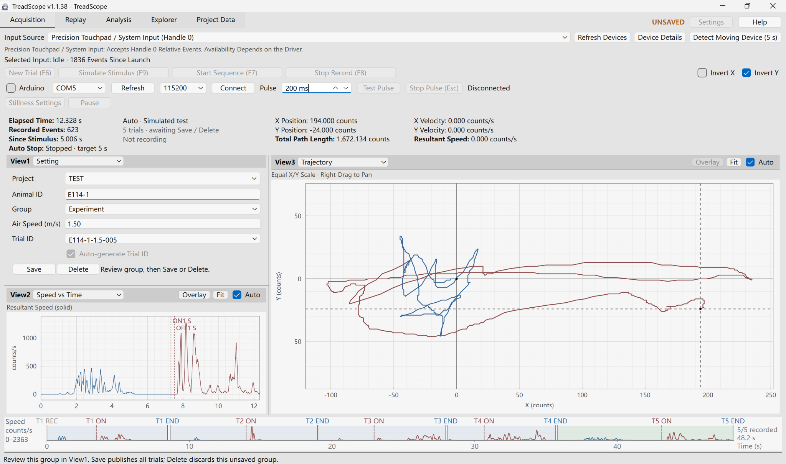
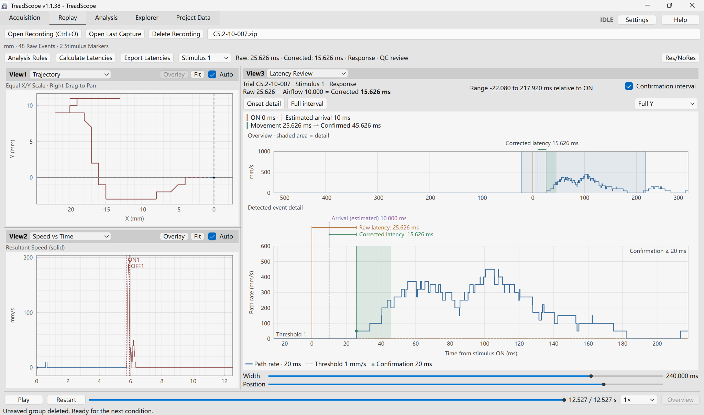

# TreadScope

**Acquisition, stimulus control, replay, and analysis for spherical treadmill experiments.**

TreadScope is a Windows desktop application for recording movement from an optical mouse sensor and linking it to stimulus events. It supports manual capture, state-triggered trial sequences, trial-by-trial review, project-level quality control, and export to R.

**Version:** 1.1.38 · **Author:** Zhengyu Qian ([Axia10032](https://github.com/Axia10032))



*Acquisition after a five-trial simulated sequence. The shaded green span identifies the trial shown in the trajectory and speed plots.*

## Install on Windows

Extract the Windows source package and open Command Prompt in the folder containing `treadscope.py`. Install Python first, then run:

```bat
py -m venv .venv
.venv\Scripts\python.exe -m pip install -r requirements.txt
.venv\Scripts\python.exe treadscope.py
```

After setup, double-click `run.bat` to launch using the same environment. The source package does not include Python or a Windows installer. Arduino hardware is optional for simulated stimulation. R and RStudio are separate installations for the optional model workflow.

## Workflow

| Workspace | What to do |
| --- | --- |
| **Acquisition** | Select the physical Raw Input sensor and verify it with **Detect Moving Device**. Set X/Y calibration from measured travel. For an automated condition, open **Stillness Settings**, enter the animal, airspeed, trial count and timing, then choose the trigger rules. Run the sequence, click the shaded trial spans to inspect recordings, and save or discard the staged group. With Arduino off, the sequence uses simulated stimulus markers. |
| **Replay** | Open a saved ZIP and choose **Latency Review** for a plot of stimulus ON, estimated airflow arrival, detected event and its confirmation. Saved automated sequences open with a clickable group overview; the footer button switches between that overview and single-recording playback progress. |
| **Analysis** | Use **Analysis Rules** to define a response, **Calculate All** to apply the settings to the selected scope, and the searchable project, group, day, animal and airspeed filters to narrow the dataset. Simulated events are excluded unless enabled. Export latencies, statistics or a recording summary. |
| **Explorer** | Compare stimulus-aligned movement, response probability, cumulative response and distance, per-animal results, heatmaps and trial progression. Related categorical plots place groups at the same airspeed next to each other. |
| **Project Data** | Search or filter the project catalog; inspect the selected recording's motion, derived results, metadata and history. Edit labels, exclude or restore with a reason, open Replay, analyze a selection, or export recording-level and stimulus-level CSVs. |

## Configure triggering, detection and review

| Setting | What it controls |
| --- | --- |
| **Stillness & Automation** | **When to stimulate.** Combine sustained stillness, sustained movement and sustained speed range with **Any / All**. Set hold durations and measurement windows, the minimum stop-to-next-ON interval, the time to keep recording after ON, and an optional wait limit. The post-ON recording time and the stimulus pulse length are separate controls. |
| **Analysis Rules** | **What counts as a response.** Use movement onset, a pause, a speed increase over baseline, or a heading change, individually or combined. Set the trailing measurement window, continuous confirmation, pre-ON baseline, post-ON search and optional airflow correction. |
| **Quality Review Rules** | **What to inspect manually.** Flag recording faults, timing issues or out-of-range latency, peak speed, path length and net displacement. Yellow indicates pending review; green indicates confirmed review. Use **Review Flag** to open Replay at the reported time when available. A QC flag or confirmation leaves response status and statistical inclusion unchanged. |



*Single-recording Replay. The estimated airflow delay is subtracted from raw latency. The shaded confirmation interval is displayed separately from the event time.*

## Data and R export

Recording ZIPs retain raw motion, stimulus events and acquisition metadata. Project-level analysis, edits and QC confirmations are stored in SQLite. Keep the recording archives and `project.sqlite` together when backing up a project. Host timestamps describe software receipt; characterize stimulus timing and calibrate airflow delay for your own setup.

The R button exports a snapshot of the current Analysis filters, with a generated R project and model script. The included templates fit a binomial mixed model for response probability and log-scale mixed models for positive continuous outcomes. Check eligibility, model warnings and diagnostics before inference. The template includes an animal random intercept; it does not adjust for day or trial order.

## Documentation

- [Release notes for v1.1.38](docs/release-v1.1.38.md)
- [Version-by-version changelog since v1.1.21](CHANGELOG.md)
- [Screenshots of the five workspaces and three settings dialogs](docs/screenshots.md)
- [Recording format, timing and R models](docs/data-and-timing.md)
- [Hardware integration and serial protocol](docs/hardware.md)
- [Citation metadata](CITATION.cff)

A matching Arduino sketch and downloadable example recording are not included. Live hardware recording requires Windows. A project license has not yet been assigned; third-party dependencies retain their respective licenses.

Developed by **Zhengyu Qian**. Thanks to the **University of Toronto Scarborough (UTSC)** for providing opportunities to test TreadScope.

**Related work:** Lott, G. K., Rosen, M. J., and Hoy, R. R. (2007). An Inexpensive Sub-Millisecond System for Walking Measurements of Small Animals Based on Optical Computer Mouse Technology. *Journal of Neuroscience Methods*, 161, 55–61.
